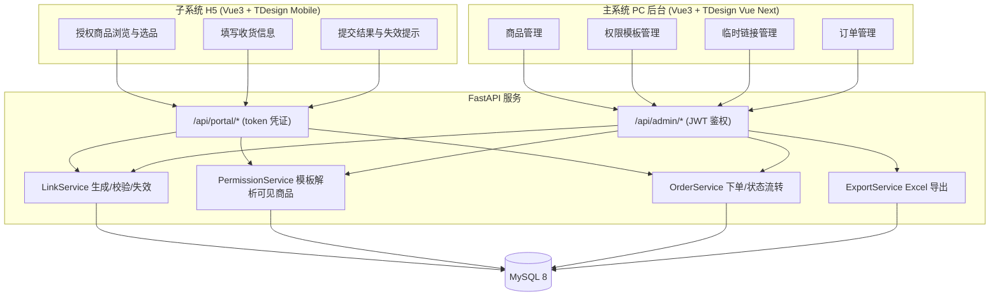

## 产品概述

一套由主系统统一管控、通过临时链接向外部下单用户开放的下单平台。主系统负责商品与权限维护、生成临时链接、汇总并流转订单；子系统无需注册，凭链接即可浏览被授权商品并提交订单。

## 核心功能

**主系统（PC 管理后台）**

- 管理员登录与退出
- 商品维护：新增、编辑、下架、删除，支持按名称/分类/状态筛选与分页
- 权限模板维护：以「可见商品集合」为单位建立可复用模板，支持按分类批量勾选商品；模板可编辑、复制、停用
- 临时链接管理：生成链接时逐项配置参数——套用的权限模板、有效期（永久或指定到期时间）、可用次数（不限或指定次数）、是否一次性（下单成功即失效）、备注；生成后展示完整 URL 并提供一键复制与二维码；支持启用、禁用、作废
- 链接状态展示：未使用、使用中、已过期、次数耗尽、已禁用
- 订单查看：列表展示订单号、来源链接、客户姓名、电话、金额、状态、下单时间，支持按订单号/来源链接/状态/时间范围筛选，详情内展示收货地址与商品明细
- 订单状态流转：待发货 → 已发货 → 已完成，可取消；非法流转（如已完成回退）被拒绝
- 报表导出：订单数据、商品数据导出为 Excel 文件

**子系统（临时链接进入的 H5 页面）**

- 凭链接直接进入，无需注册登录
- 仅能看到该链接被授权的商品，未授权商品不可见、不可下单
- 商品浏览与选品：图片、名称、价格、数量增减，实时合计金额
- 填写收货信息（姓名、电话、详细地址）与订单备注后提交
- 提交成功展示结果页；链接过期、次数耗尽、被禁用时展示对应的失效提示页

## 视觉与交互效果

主系统采用左侧深色导航 + 右侧浅色内容区的经典后台布局，表格与表单以卡片承载，筛选、弹窗、抽屉交互顺畅；临时链接生成弹窗内参数项以开关与选择器呈现，生成后即时显示可复制的链接与二维码。子系统为移动端 H5，商品以大图卡片瀑布流呈现，底部常驻悬浮结算栏实时显示合计金额，表单输入有即时校验反馈，失效页以醒目的状态图标与说明文案提示原因。

## 技术栈选择

- 后端：Python 3.11 + FastAPI + Uvicorn
- ORM/迁移：SQLAlchemy 2.0（声明式模型）+ Alembic（建表与版本管理）
- 数据库：MySQL 8（utf8mb4）
- 鉴权：主系统用 JWT（PyJWT）+ bcrypt 密码哈希；子系统不鉴权，以链接 token 作为访问凭证
- 导出：openpyxl（流式写出 xlsx）
- 主系统前端：Vue 3 + TypeScript + Vite + TDesign Vue Next（后台组件体系）+ Pinia + Vue Router
- 子系统前端：Vue 3 + TypeScript + Vite + TDesign Mobile Vue（移动端组件）+ Pinia + Vue Router
- 说明：以上为已与用户确认的默认栈（Python / Vue3 / MySQL，主系统 PC、子系统 H5）。主系统与子系统拆为两个独立前端工程，原因是二者设计体系（桌面端 vs 移动端）、打包体积与构建目标差异大，合并会互相拖累体积与样式；两者共用同一套后端 API。

## 实现思路

核心链路为：**权限模板决定可见商品集合 → 临时链接套用模板并携带有效期/次数约束 → 子系统凭 token 换取授权商品并下单 → 主系统查看与流转订单**。

关键决策与理由：

1. **链接状态运行期判定，不做定时任务**：数据库只持久化 `active` / `disabled` 两种显式状态，`expired`（对比 `expire_at`）与 `exhausted`（对比 `used_count` 与 `max_uses`）在查询时实时计算并对外展示。避免引入定时任务与状态不同步问题，实现更简单可靠。
2. **token 使用 `secrets.token_urlsafe(32)` 生成并入库**，URL 形如 `/portal?t={token}`。不使用自增 ID 或可猜测编码，防止遍历他人链接。
3. **次数扣减采用条件行级更新保证原子性**：`UPDATE temp_link SET used_count = used_count + 1 WHERE id = :id AND status = 'active' AND (max_uses IS NULL OR used_count < max_uses) AND (expire_at IS NULL OR expire_at > NOW())`，依据 `rowcount` 判断是否成功。相比「先查再写」可防止并发下超发链接次数。
4. **授权校验一律在服务端完成**：子系统下单时只接收 `token` 与 `product_id/quantity`，服务端重新由 token → 模板 → 商品集合推导并校验，绝不信任前端提交的可见商品范围，防止越权下单。
5. **订单落库时对商品名称、单价做快照**（`order_item.product_name` / `price` 冗余存储），避免商品后续改价影响历史订单金额。
6. **权限模板与商品为多对多**（`template_product` 关联表），模板作为链接可见范围的唯一来源；「按分类批量勾选」仅作为前端的批量录入交互，落库仍写具体商品集合，保证解析逻辑单一。

性能与可靠性：

- 全部列表接口分页（`page`/`page_size`），禁止全表返回。
- 关键索引：`temp_link.token`（唯一）、`temp_link.status`、`order.link_id`、`order.status`、`order.created_at`、`order_item.order_id`、`template_product.template_id`。
- 订单列表读取明细时使用 `selectinload` 预加载，规避 N+1 查询。
- Excel 导出使用 `openpyxl` 的只写模式（`write_only`）配合 `StreamingResponse` 分块输出，避免大表全量驻留内存。

## 实现要点

- **复用现有模式**：项目为全新空目录，无既有代码可复用，因此统一由 `core/`（配置、安全、依赖注入）、`models/`（ORM）、`schemas/`（Pydantic）、`services/`（业务逻辑）、`api/`（路由）五层划分，路由层只做参数校验与编排，业务规则全部下沉到 `services/`，避免逻辑散落。
- **前端与后端契约**：统一响应体 `{code, message, data}`；`code` 非 0 表示业务失败，前端据此统一提示。子系统接口在失败时返回明确原因码（如 `LINK_EXPIRED` / `LINK_EXHAUSTED` / `LINK_DISABLED`），供 H5 渲染不同失效文案。
- **日志**：复用 Python `logging` 按级别输出到控制台与文件；记录链接生成、链接校验失败原因、订单创建与状态变更等关键事件；禁止打印 token 明文之外的敏感信息（收货电话在日志中脱敏），错误日志不整体 dump 请求体。
- **影响范围控制**：新增工程不触碰任何既有文件；数据库结构通过 Alembic 迁移管理，便于后续增量变更；金额统一用 `Decimal` 存储，禁止用浮点。
- **输入校验与安全**：Pydantic 校验必填项、手机号格式、地址长度上限；商品价格与数量在服务端二次校验；对同一 token 的提交做轻量频率限制（基于内存计数的简单节流），防止刷单。

## 架构设计



## 目录结构

```
web-sales/
├── backend/
│   ├── app/
│   │   ├── main.py                          # [NEW] FastAPI 应用入口：创建 app、注册 CORS、挂载 admin/portal 路由、统一异常处理
│   │   ├── core/
│   │   │   ├── config.py                    # [NEW] 配置：数据库连接串、JWT 密钥与过期时间、默认链接参数；从环境变量读取
│   │   │   ├── security.py                  # [NEW] 密码 bcrypt 哈希/校验、JWT 签发与解析、token 随机生成
│   │   │   └── deps.py                      # [NEW] 依赖注入：get_db 会话、get_current_admin 管理员鉴权
│   │   ├── db/
│   │   │   ├── base.py                      # [NEW] SQLAlchemy DeclarativeBase 与公共时间戳字段
│   │   │   └── session.py                   # [NEW] 引擎、SessionLocal、建表入口
│   │   ├── models/
│   │   │   ├── admin.py                     # [NEW] Admin 管理员模型
│   │   │   ├── product.py                   # [NEW] Category 分类 + Product 商品（价格用 Decimal、状态上下架）
│   │   │   ├── permission.py                # [NEW] PermissionTemplate 权限模板 + TemplateProduct 模板商品关联表
│   │   │   ├── temp_link.py                 # [NEW] TempLink 临时链接：token、template_id、expire_at、max_uses、used_count、is_single_use、status
│   │   │   └── order.py                     # [NEW] Order 订单 + OrderItem 明细（商品名称/单价快照）
│   │   ├── schemas/
│   │   │   ├── common.py                    # [NEW] 统一响应体与分页入参/出参基类
│   │   │   ├── product.py                   # [NEW] 商品与分类的请求/响应模型
│   │   │   ├── permission.py                # [NEW] 权限模板请求/响应模型
│   │   │   ├── temp_link.py                 # [NEW] 链接生成请求（模板、有效期、次数、一次性）与响应（含完整 URL）
│   │   │   └── order.py                     # [NEW] 下单请求（收货信息 + 明细）、订单响应、状态流转请求
│   │   ├── services/
│   │   │   ├── link_service.py              # [NEW] 链接生成、状态判定（过期/耗尽/禁用）、原子扣减使用次数、禁用与作废
│   │   │   ├── permission_service.py        # [NEW] 由模板解析可见商品集合、下单时校验商品是否在授权范围内
│   │   │   ├── order_service.py             # [NEW] 创建订单与明细、金额计算、状态流转合法性校验、订单查询与预加载
│   │   │   └── export_service.py            # [NEW] 订单/商品数据导出为 xlsx（openpyxl 只写模式）
│   │   ├── api/
│   │   │   ├── admin/
│   │   │   │   ├── auth.py                  # [NEW] 管理员登录接口，签发 JWT
│   │   │   │   ├── products.py              # [NEW] 商品与分类 CRUD、分页筛选
│   │   │   │   ├── permissions.py           # [NEW] 权限模板 CRUD 与可见商品设置
│   │   │   │   ├── links.py                 # [NEW] 链接生成、列表、禁用/启用、作废
│   │   │   │   ├── orders.py                # [NEW] 订单列表、详情、状态流转
│   │   │   │   └── exports.py               # [NEW] 订单/商品 Excel 导出接口
│   │   │   └── portal/
│   │   │       ├── catalog.py               # [NEW] 凭 token 获取链接信息与授权商品列表
│   │   │       └── checkout.py              # [NEW] 匿名下单提交、链接失效原因码返回
│   │   └── utils/
│   │       └── exceptions.py                # [NEW] 业务异常类与统一错误码（LINK_EXPIRED / LINK_EXHAUSTED 等）
│   ├── alembic/                             # [NEW] 数据库迁移脚本目录
│   ├── requirements.txt                     # [NEW] 后端依赖清单
│   └── .env.example                         # [NEW] 环境变量示例（数据库、JWT 密钥、前端访问地址）
├── frontend-admin/
│   ├── src/
│   │   ├── main.ts                          # [NEW] 挂载 Vue 应用、注册 TDesign Vue Next、Pinia、Router
│   │   ├── api/                             # [NEW] 后端接口封装（axios 实例、请求拦截注入 JWT、统一错误提示）
│   │   ├── router/index.ts                  # [NEW] 后台路由与登录态守卫
│   │   ├── stores/                          # [NEW] 管理员登录态与全局状态
│   │   ├── layouts/AdminLayout.vue          # [NEW] 左侧深色导航 + 顶部栏 + 内容区布局
│   │   ├── views/
│   │   │   ├── Login.vue                    # [NEW] 登录页
│   │   │   ├── ProductList.vue              # [NEW] 商品管理（筛选、表格、新增/编辑抽屉）
│   │   │   ├── PermissionTemplate.vue       # [NEW] 权限模板管理（分类树 + 商品多选）
│   │   │   ├── TempLinkList.vue             # [NEW] 临时链接管理（生成弹窗、复制、二维码、启停作废）
│   │   │   └── OrderList.vue                # [NEW] 订单管理（筛选、详情抽屉、状态流转、导出）
│   │   └── components/                      # [NEW] 链接生成弹窗、商品选择器等可复用组件
│   ├── package.json                         # [NEW] 主系统前端依赖与脚本
│   └── vite.config.ts                       # [NEW] 构建配置与开发代理
├── frontend-portal/
│   ├── src/
│   │   ├── main.ts                          # [NEW] 挂载 H5 应用、注册 TDesign Mobile Vue
│   │   ├── api/                             # [NEW] 子系统接口封装（自动附带链接 token）
│   │   ├── router/index.ts                  # [NEW] H5 路由
│   │   ├── views/
│   │   │   ├── ProductBrowse.vue            # [NEW] 授权商品浏览与选品、底部悬浮结算栏
│   │   │   ├── Checkout.vue                 # [NEW] 收货信息填写与提交
│   │   │   └── Result.vue                   # [NEW] 下单成功页与链接失效提示页
│   │   └── components/                      # [NEW] 商品卡片、数量步进器等组件
│   ├── package.json                         # [NEW] 子系统前端依赖与脚本
│   └── vite.config.ts                       # [NEW] 构建配置与开发代理
└── README.md                                # [NEW] 项目说明：启动步骤、环境变量、目录说明、核心流程
```

## 关键数据结构

```python
class LinkStatus(str, Enum):
    ACTIVE = "active"        # 持久化状态
    DISABLED = "disabled"    # 持久化状态（手动作废）

class DerivedStatus(str, Enum):
    UNUSED = "unused"        # 运行期派生，仅用于展示
    IN_USE = "in_use"
    EXPIRED = "expired"
    EXHAUSTED = "exhausted"
    DISABLED = "disabled"

class TempLink(Base):
    __tablename__ = "temp_link"
    id: Mapped[int] = mapped_column(primary_key=True)
    token: Mapped[str] = mapped_column(String(64), unique=True, index=True)
    template_id: Mapped[int] = mapped_column(ForeignKey("permission_template.id"))
    remark: Mapped[str | None]
    expire_at: Mapped[datetime | None]   # NULL 表示永久有效
    max_uses: Mapped[int | None]         # NULL 表示不限次数
    used_count: Mapped[int] = mapped_column(default=0)
    is_single_use: Mapped[bool] = mapped_column(default=False)  # 下单成功即禁用
    status: Mapped[LinkStatus] = mapped_column(default=LinkStatus.ACTIVE)
    created_at: Mapped[datetime]
    last_accessed_at: Mapped[datetime | None]
```

> 说明：`expired` / `exhausted` / `unused` / `in_use` 均在查询时由 `expire_at`、`max_uses`、`used_count` 实时推导，不落库、不依赖定时任务。

## 设计架构

主系统采用「左侧深色导航 + 右侧浅色工作区」的企业级后台布局，基于 Vue 3 + TDesign Vue Next；子系统采用移动端优先的 H5 设计，基于 Vue 3 + TDesign Mobile Vue。两端共用同一套品牌主色与圆角、间距规范，形成一致的产品识别。

## 主系统页面规划（5 屏）

**1. 登录页**

- 左侧品牌区：深蓝渐变背景叠加柔光斑与细网格纹理，展示产品名与一句话说明，营造专业感
- 右侧登录卡：悬浮白卡带柔和阴影，账号与密码输入框、显示密码图标、记住我、主色渐变登录按钮，错误时输入框下方红色提示并轻微抖动
- 底部版权与版本号

**2. 商品管理**

- 顶部导航栏：产品标识、面包屑、管理员头像下拉菜单
- 筛选工具栏：关键词搜索、分类下拉、状态筛选、右侧主色「新增商品」按钮
- 商品表格：图片缩略图、名称、SKU、分类、价格（右对齐等宽数字）、状态标签、操作列
- 新增/编辑抽屉：从右侧滑出，含图片、名称、分类、价格、单位、描述字段与即时校验
- 底部分页器，表格行悬浮高亮

**3. 权限模板管理**

- 顶部导航栏
- 左侧模板列表：卡片式排列，显示模板名、可见商品数、状态开关
- 右侧商品选择区：左分类树 + 右商品多选列表，支持按分类全选与关键词过滤
- 底部固定操作条：保存、另存为副本
- 未选商品时展示引导性空态插画

**4. 临时链接管理**

- 顶部导航栏
- 链接表格：备注、套用模板、有效期、剩余次数、状态标签（未使用/使用中/已过期/次数耗尽/已禁用，不同色）、访问次数、操作
- 生成链接弹窗：模板选择、有效期（永久/指定时间）、可用次数（不限/指定）、一次性开关、备注，参数项以开关与选择器分组呈现
- 生成结果区：高亮展示完整 URL、一键复制按钮、二维码，复制成功有轻提示
- 行操作：启用、禁用、作废，危险操作二次确认

**5. 订单管理**

- 顶部导航栏
- 筛选区：订单号、来源链接、状态、下单时间范围、右侧「导出 Excel」按钮
- 订单表格：订单号、客户姓名、电话、金额、状态标签、下单时间
- 详情抽屉：收货地址卡片、商品明细表、底部状态流转按钮组（发货/完成/取消），非法流转置灰
- 分页器与空态提示

## 子系统页面规划（1 屏）

**6. 子系统 H5 下单页**

- 顶部信息条：来源链接备注与剩余有效期倒计时提示，浅色渐变背景
- 商品卡片列表：大图卡片、名称、单价、右下角数量步进器，加入时卡片轻微弹动反馈
- 底部悬浮结算栏：毛玻璃质感，左侧实时合计金额，右侧渐变主色「去结算」按钮
- 结算表单：收货人、手机号、详细地址、备注，输入即时校验并给出错误提示
- 结果页：下单成功显示订单号与勾选动画；链接失效时按原因显示不同图标与文案（已过期/次数耗尽/已禁用）

## 交互与响应式

- 主系统：卡片与表格悬浮微抬升，抽屉与弹窗带缓动过渡；侧边导航可折叠；内容区最小宽度 1280px，窄屏时表格横向滚动
- 子系统：所有可点击元素触控高度不小于 44px，列表滚动懒加载，表单聚焦时页面自动滚动到可视区；适配 375px 至 430px 宽度

## Agent Extensions

### Skill

- **playwright-cli**
- Purpose: 在临时链接下单闭环完成后，驱动浏览器对主系统与子系统进行端到端验证——登录后台、创建权限模板、生成临时链接、在 H5 页打开链接选品下单、回到后台确认订单出现并完成状态流转
- Expected outcome: 输出可复现的端到端验证结果与关键页面截图，暴露并定位前后端联调、token 校验、次数扣减、越权拦截等环节的真实问题，并据此修复